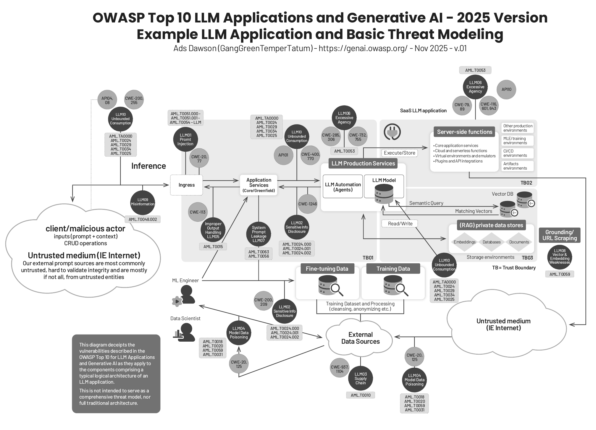
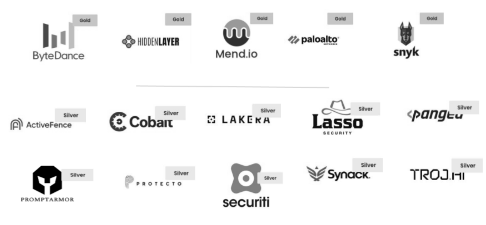

# Appendix 1: LLM Application Architecture and Threat Modeling

## OWASP Top 10 LLM Applications and Generative AI – 2025 Version

### Example LLM Application and Basic Threat Modeling

Ads Dawson (GangGreenTemperTatum) – <https://genai.owasp.org/> – Nov 2025 – v.01

This diagram depicts the vulnerabilities described in the OWASP Top 10 for LLM Applications and Generative AI as they apply to the components comprising a typical logical architecture of an LLM application.

This is not intended to serve as a comprehensive threat model, nor full traditional architecture.

## Projektsponsoren

Wir bedanken uns bei unseren Projektsponsoren für ihre finanziellen Beiträge, die dazu beitragen, die Ziele des Projekts zu unterstützen und die Betriebs- und Öffentlichkeitsarbeitskosten zu decken, indem sie die von der OWASP.org-Stiftung bereitgestellten Ressourcen aufstocken. Das Projekt „OWASP Top 10 für LLM und Generative KI“ verfolgt weiterhin einen anbieterneutralen und unvoreingenommenen Ansatz. Sponsoren erhalten im Rahmen ihrer Unterstützung keine besonderen Governance-Erwägungen. Sponsoren erhalten jedoch Anerkennung für ihre Beiträge in unseren Materialien und Web-Inhalten. Alle Materialien, die im Rahmen des Projekts erstellt werden, werden von der Community entwickelt, vorangetrieben und unter Open-Source- und Creative-Commons-Lizenzen veröffentlicht. Weitere Informationen zur Übernahme einer Sponsorenrolle finden Sie im Bereich „Sponsoring“ auf unserer Website. Dort erfahren Sie mehr darüber, wie Sie das Projekt durch Sponsoring unterstützen können.

### Gold

- ByteDance
- HiddenLayer
- Mend.io
- Palo Alto Networks
- Snyk

### Silver

- ActiveFence
- Cobalt
- Lakera
- Lasso Security
- Pangea
- PromptArmor
- Protecto
- Securiti
- Synack
- TrojAI

## Supporters

Project supporters lend their resources and expertise to support the goals of the project.

- HADESS
- KLAVAN
- Precize
- AWS
- Snyk
- Astra Security
- AWARE7 GmbH
- iFood
- Kainos
- Aigos
- Cloud Security Podcast
- Trellix
- Coalfire
- HackerOne
- IBM
- Bearer
- Bit79
- Stackarmor
- Cohere
- Quiq
- Lakera
- Credal.ai
- Palosade
- Prompt Security
- NuBinary
- Balbix
- SAFE Security
- BeDisruptive
- Preamble
- Nexus
- PromptArmor
- Exabeam
- Modus Create
- IronCore Labs
- Cloudsec.ai
- Layerup
- Mend.io
- Giskard
- BBVA
- RHITE
- Praetorian
- Cobalt
- Nightfall AI
