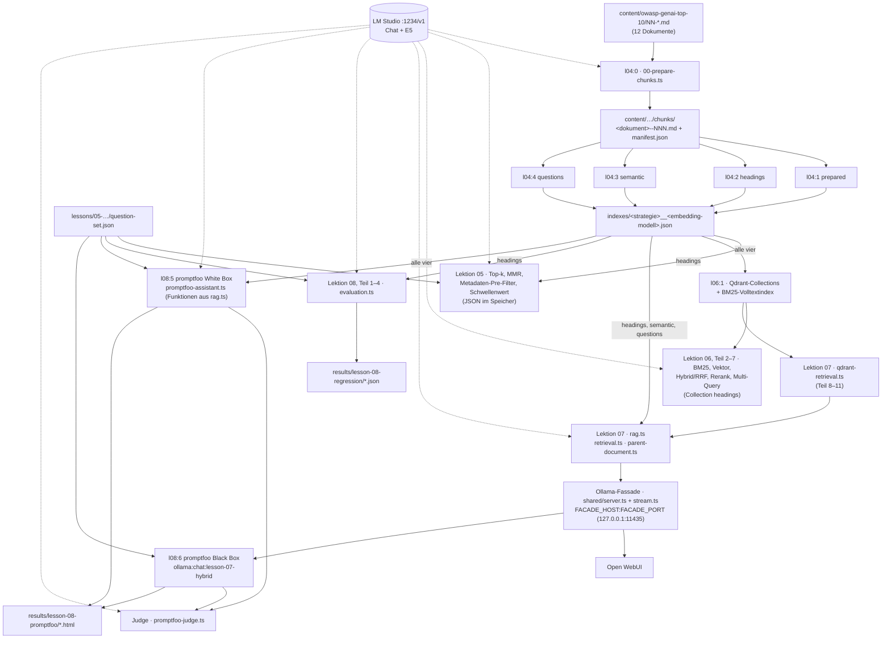

# Architektur: Datenfluss, Artefakte, Verträge

*English version: [architecture.md](architecture.md)*

Diese Seite zeigt, wie die Lektionen zusammenhängen: wer welche Datei schreibt, wer sie liest und welche Regeln an den Übergängen gelten. Einzelheiten zu einem Teil stehen im Dateikopf der Lektionsdatei.

## Datenfluss

**Als Text:**

1. `l04:0` schneidet die zwölf Markdown-Dokumente in Chunks unter dem E5-Limit (512 Tokens) und schreibt `chunks/<dokument>--NNN.md` plus `chunks/manifest.json`.
2. `l04:1` bis `l04:4` bauen daraus je einen Index: `indexes/<strategie>__<REMOTE_EMBEDDING_MODEL_NAME>.json` mit `prepared`, `headings`, `semantic` oder `questions`. `l04:5` (Parent-Document) liest `headings` und schreibt nichts.
3. Lektion 05 lädt `headings` als JSON in den Speicher und vergleicht Top-k, MMR, Metadaten-Pre-Filter und Schwellenwert.
4. `l06:1` lädt **alle vier** Indizes in je eine Qdrant-Collection (`<strategie>__<modell>`) mit BM25-Volltextindex. Teil 2 bis 7 suchen in der Collection `headings` (`INDEX_STRATEGY` in `hybrid.ts`): BM25, Vektor, Hybrid mit RRF, Reranking, Multi-Query.
5. Lektion 07 baut daraus RAG: `rag.ts` (Index laden, Pre-Filter, Prompt, Stream mit Quellenliste), `retrieval.ts` (MMR, Filter, Schwellenwert im Speicher), `parent-document.ts`, `qdrant-retrieval.ts` (Teil 8 bis 11 über Qdrant). Die Fassade (`shared/server.ts`, `shared/stream.ts`) spricht Ollama-API mit Open WebUI.
6. Lektion 08, Teil 1 bis 4 (`evaluation.ts`) messen mit `question-set.json` aus Lektion 05. Teil 5 (promptfoo) ruft über `promptfoo-assistant.ts` dieselben Funktionen aus `rag.ts` auf, je Strategie ein Provider (White Box). Teil 6 fragt die laufende Fassade über die Ollama-API (Black Box). Beide nutzen den Judge `promptfoo-judge.ts`.

## Wer welchen Index liest

| Artefakt | Erzeugt von | Gelesen von |
|---|---|---|
| `chunks/` + `manifest.json` | `l04:0` | L04, Teil 1–4 |
| Index `prepared` | `l04:1` | L06, Teil 1; L08, Teil 5 (`corpus:prepared`) |
| Index `headings` | `l04:2` | L04, Teil 5; L05, Teil 1–5; L06, Teil 1; L07, Teil 1, 4–7, 11; L08, Teil 1–4 und 5 (`corpus:headings`) |
| Index `semantic` | `l04:3` | L06, Teil 1; L07, Teil 2, 11; L08, Teil 5 (`corpus:semantic`) |
| Index `questions` | `l04:4` | L06, Teil 1; L07, Teil 3, 11; L08, Teil 5 (`corpus:questions`) |
| Qdrant-Collection `headings__…` | `l06:1` | L06, Teil 2–7; L07, Teil 8–11; über die Fassade L08, Teil 6 |
| Qdrant-Collections `prepared__…`, `semantic__…`, `questions__…` | `l06:1` | Nur, wenn `INDEX_STRATEGY` in `hybrid.ts` geändert wird (L06, Teil 2) |
| `question-set.json` | von Hand (Lektion 05) | L05, Teil 5; L08, Teil 1–6 |
| `results/lesson-08-regression/` | L08, Teil 4 | L08, Teil 4 (nächster Lauf) |

## Verträge

| Vertrag | Festgelegt in | Geprüft durch | Wenn er bricht |
|---|---|---|---|
| Chunk-Manifest | `lessons/04-chunking/formats.ts` (`MANIFEST_FORMAT_VERSION`, `manifestSchema`) | `readManifest` in `chunking.ts`: Version, Schema, Limit 512, Präfix `passage: ` | "The chunk manifest is invalid or outdated" → `npm run l04:0` |
| Token-Zählung | `lessons/04-chunking/tokenizer.ts` (feste Revision, SHA256), `COUNTING_METHOD` in `formats.ts` | `createCounter` in `00-prepare-chunks.ts`: Tokenizer vor Server-Methoden vor Schätzung; `--verify` prüft die Zahlen | Warnung "Local E5 tokenizer unavailable" → `npm run tokenizer:fetch` |
| Indexdatei | `lessons/shared/index.ts` (`INDEX_FORMAT_VERSION`, `indexEntrySchema`, `questionEntrySchema`); Name aus `indexFileFor` | `readIndex`: Version und zod-Schema; geschrieben atomar (`.tmp` + Umbenennen) | "invalid or outdated" bzw. "Cannot load index" mit `l04:0` und `l04:N` |
| Modell im Namen | `indexFileFor` (Index), `collectionNameFor` (Qdrant) | Dateiname: anderes Embedding-Modell → andere Datei | Fehlende Datei → "Cannot load index" |
| Zugriffsgruppe | `metadata.accessGroup` (`public`/`internal`), gesetzt in Lektion 04; `INTERNAL_DOCUMENTS` und `isPublicChunk` in `shared/index.ts` | Pre-Filter vor der Suche: `loadPublicIndex` (L05, L08 Teil 2/3), `loadRagIndex` (L07, L08 Teil 5); Qdrant: `PUBLIC_FILTER` an **jedem** `prefetch` und an der fusionierten Anfrage (`qdrant-retrieval.ts`) | Bewusst ungefiltert: Lektion 06 und Lektion 08, Teil 1 und 4 (F-11 erwartet den Anhang) |
| E5-Präfixe | `e5Model` in `shared/embeddings.ts` | Fragen über `embeddingQuery` (`query: `, gekürzt auf `QUERY_CHARACTER_LIMIT`); Chunks mit `passage: ` in Lektion 04; generierte Fragen mit `query: ` | Kein Fehler, nur schlechtere Treffer (Lektion 03, Teil 3) |
| Quellenlabel | `sourceLabelFor` in `lessons/07-rag-open-webui/rag.ts` (`[n] datei · pfad`); Listenformat `SOURCE_LIST_PREFIX` in `shared/text.ts` | Kontext, Logzeile `RAG sources` und Fußzeile nutzen dieselbe Funktion; `06-promptfoo-black-box.yaml` sucht `\n---\n**Quellen` | Format ändern → YAML von Teil 6 mitändern |
| Fragen-Set | `questionSetSchema` in `lessons/05-retrieval-strategies/retrieval.ts` | `loadQuestionSet` (zod) | "Cannot load the question set" |
| Fassade | `ollama-api-facade-js` 1.0.7, `shared/facade.ts` (`EXPECTED_FACADE_VERSION`) | `prepareFacade` und `rawResponse` prüfen Version und Form | Klarer Fehler beim Start statt stiller Defekt |

## Wer besitzt was (`lessons/shared/`)

Die Infrastruktur aller Lektionen liegt in `lessons/shared/`: Einstellungen (`config.ts`), Start und Logging, Burp (`proxy.ts`), Ollama-Fassade (`server.ts`, `stream.ts`, `facade.ts`), Embeddings (`embeddings.ts`) und Index (`index.ts`). Zweck, Exporte und Besonderheiten jedes Moduls stehen an einer Stelle: [`lessons/shared/README.de.md`](../lessons/shared/README.de.md#module).

## Bekannte Grenzen

| Grenze | Beleg | Folge |
|---|---|---|
| Der Qdrant-Client umgeht Burp | `@qdrant/js-client-rest` (geprüft mit 1.20.0; `package.json`: `^1.20.0`) baut einen eigenen undici-`Agent` (`dist/esm/dispatcher.js`); Kommentar in `hybrid.ts` | Anfragen an Qdrant fehlen in Burps History; das Dashboard (`<QDRANT_URL>/dashboard`) zeigt den Inhalt |
| Embedding-Aufrufe lassen sich nicht abbrechen | LangChain `embedQuery`/`embedDocuments` nehmen kein Signal; `abortable` hört nur auf zu warten (`embedRagQuestion` in `rag.ts`). Ebenso der Qdrant-Client. | Nach "Stopp" in Open WebUI läuft die Anfrage auf dem Server weiter |
| Fassade fest auf `ollama-api-facade-js` 1.0.7 | `package.json` ohne `^`; `stream.ts` liest das private Feld `response` per `Reflect.get` | Kein Update ohne Prüfung; `npm audit` meldet Funde über die Fassade (siehe Wurzel-README) |
| Ein Port, eine Fassade | Alle Chat-Teile nutzen `FACADE_PORT` | Zweiter Start → "FACADE_PORT … is in use" |
| Fassade und Qdrant ohne Anmeldung | `.env.example`, Wurzel-README | Nur an `127.0.0.1` binden |
| Index als JSON im Speicher | `readIndex` lädt die ganze Datei, `rankEntries` vergleicht mit jedem Eintrag | Reicht für den Korpus, skaliert nicht (siehe [production.de.md](production.de.md)) |
| Fragen-Index nur anhängend | `04-question-generation-chunking.ts` überspringt vorhandene Chunks | Nach geänderten Einstellungen Indexdatei löschen |
| Demo-Werte sind Kopien | `lessons/07-rag-open-webui/demo.ts` | Änderungen in Teil 1 bis 10 wirken nicht in `l07:11` |

## Namensfallen

| Falle | Richtig ist |
|---|---|
| Zwei `DEFAULT_TOP_K` | `shared/index.ts` = 3 (Suche in Lektion 04); `lessons/08-evaluations/promptfoo-assistant.ts` = 5 (eigene Konstante, Kontext in Teil 5) |
| Zwei `INDEX_STRATEGY` | `lessons/05-retrieval-strategies/retrieval.ts` und `lessons/06-hybrid-rerank/hybrid.ts`, beide `'headings'`, unabhängig. Die aus `hybrid.ts` steuert auch Lektion 07, Teil 8 bis 11 und damit `l08:6`. |
| Dateinummer ≠ Teilnummer | `99-full-demo.ts` ist Lektion 05 Teil 5 (`l05:5`), Lektion 06 Teil 7 (`l06:7`), Lektion 07 Teil 11 (`l07:11`). Lektion 04 beginnt mit Teil 0. Lektion 08, Teil 5 und 6 sind YAML-Dateien. |
| Zwei `retrieval.ts` | Lektion 05: Index laden, Fragen-Set, MMR. Lektion 07: `Retrieve`-Fabriken für MMR, Filter, Schwellenwert. |
| Zwei `embeddings.ts` | `shared/embeddings.ts` (E5, Kosinus, Client); `lessons/03-embeddings/embeddings.ts` (E5 + EmbeddingGemma für Lektion 03) |
| Zwei `loadIndex` | Lektion 05 (`headings`, wirft) und lokal in `06-hybrid-rerank/01-collection-load.ts` (je Strategie, überspringt bei Fehler) |
| "Teil N" ohne Lektion | In Kommentaren meint es oft den Teil der zuvor genannten Lektion, z. B. `loadRagIndex`: "headings (Teil 2)" = Lektion 04, Teil 2 |
