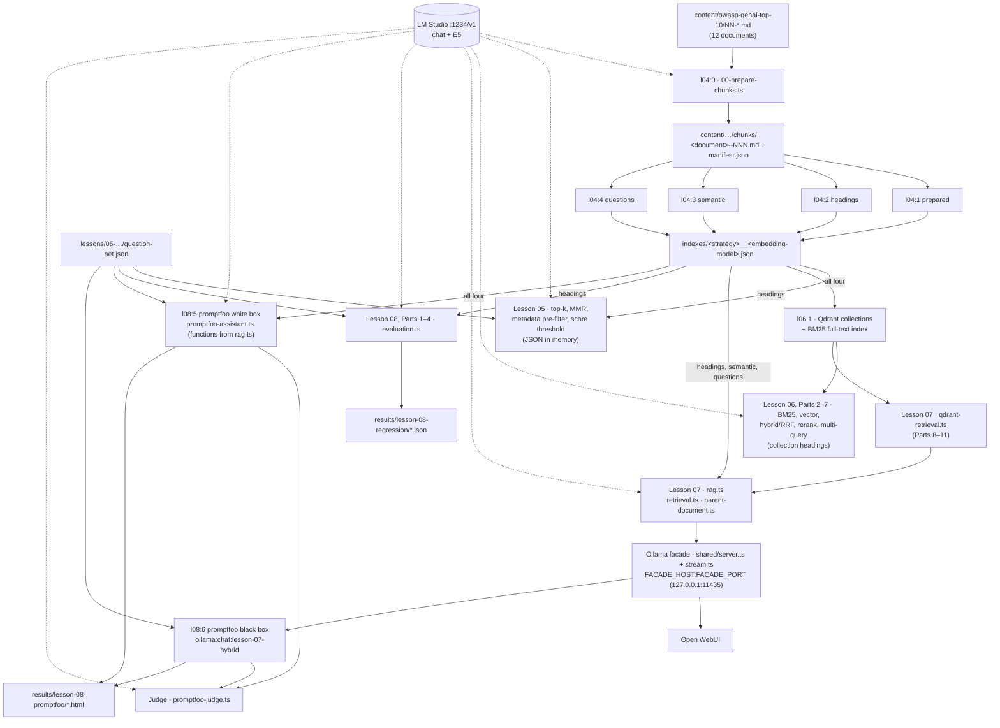

# Architecture: data flow, artefacts, contracts

*Deutsche Fassung: [architecture.de.md](architecture.de.md)*

This page shows how the lessons fit together: who writes which file, who reads it, and which rules hold at the hand-overs. Details of a single part live in the header of its lesson file.

## Data flow

**As text:**

1. `l04:0` cuts the twelve Markdown documents into chunks under the E5 limit (512 tokens) and writes `chunks/<document>--NNN.md` plus `chunks/manifest.json`.
2. `l04:1` to `l04:4` each build one index: `indexes/<strategy>__<REMOTE_EMBEDDING_MODEL_NAME>.json` with `prepared`, `headings`, `semantic` or `questions`. `l04:5` (parent document) reads `headings` and writes nothing.
3. Lesson 05 loads `headings` as JSON into memory and compares top-k, MMR, metadata pre-filter and score threshold.
4. `l06:1` loads **all four** indexes into one Qdrant collection each (`<strategy>__<model>`) with a BM25 full-text index. Parts 2 to 7 search the `headings` collection (`INDEX_STRATEGY` in `hybrid.ts`): BM25, vector, hybrid with RRF, reranking, multi-query.
5. Lesson 07 builds RAG on top: `rag.ts` (load index, pre-filter, prompt, stream with source list), `retrieval.ts` (MMR, filter, threshold in memory), `parent-document.ts`, `qdrant-retrieval.ts` (Parts 8 to 11 via Qdrant). The facade (`shared/server.ts`, `shared/stream.ts`) speaks the Ollama API to Open WebUI.
6. Lesson 08, Parts 1 to 4 (`evaluation.ts`) measure with `question-set.json` from Lesson 05. Part 5 (promptfoo) calls the same functions from `rag.ts` through `promptfoo-assistant.ts`, one provider per strategy (white box). Part 6 queries the running facade through the Ollama API (black box). Both use the judge `promptfoo-judge.ts`.

## Who reads which index

| Artefact | Created by | Read by |
|---|---|---|
| `chunks/` + `manifest.json` | `l04:0` | L04, Parts 1–4 |
| Index `prepared` | `l04:1` | L06, Part 1; L08, Part 5 (`corpus:prepared`) |
| Index `headings` | `l04:2` | L04, Part 5; L05, Parts 1–5; L06, Part 1; L07, Parts 1, 4–7, 11; L08, Parts 1–4 and 5 (`corpus:headings`) |
| Index `semantic` | `l04:3` | L06, Part 1; L07, Parts 2, 11; L08, Part 5 (`corpus:semantic`) |
| Index `questions` | `l04:4` | L06, Part 1; L07, Parts 3, 11; L08, Part 5 (`corpus:questions`) |
| Qdrant collection `headings__…` | `l06:1` | L06, Parts 2–7; L07, Parts 8–11; through the facade L08, Part 6 |
| Qdrant collections `prepared__…`, `semantic__…`, `questions__…` | `l06:1` | Only when `INDEX_STRATEGY` in `hybrid.ts` is changed (L06, Part 2) |
| `question-set.json` | by hand (Lesson 05) | L05, Part 5; L08, Parts 1–6 |
| `results/lesson-08-regression/` | L08, Part 4 | L08, Part 4 (next run) |

## Contracts

| Contract | Defined in | Checked by | When it breaks |
|---|---|---|---|
| Chunk manifest | `lessons/04-chunking/formats.ts` (`MANIFEST_FORMAT_VERSION`, `manifestSchema`) | `readManifest` in `chunking.ts`: version, schema, limit 512, prefix `passage: ` | "The chunk manifest is invalid or outdated" → `npm run l04:0` |
| Token counting | `lessons/04-chunking/tokenizer.ts` (pinned revision, SHA256), `COUNTING_METHOD` in `formats.ts` | `createCounter` in `00-prepare-chunks.ts`: tokenizer before server methods before estimate; `--verify` checks the counts | Warning "Local E5 tokenizer unavailable" → `npm run tokenizer:fetch` |
| Index file | `lessons/shared/index.ts` (`INDEX_FORMAT_VERSION`, `indexEntrySchema`, `questionEntrySchema`); name from `indexFileFor` | `readIndex`: version and zod schema; written atomically (`.tmp` + rename) | "invalid or outdated" or "Cannot load index" naming `l04:0` and `l04:N` |
| Model in the name | `indexFileFor` (index), `collectionNameFor` (Qdrant) | File name: a different embedding model → a different file | Missing file → "Cannot load index" |
| Access group | `metadata.accessGroup` (`public`/`internal`), set in Lesson 04; `INTERNAL_DOCUMENTS` and `isPublicChunk` in `shared/index.ts` | Pre-filter before the search: `loadPublicIndex` (L05, L08 Parts 2/3), `loadRagIndex` (L07, L08 Part 5); Qdrant: `PUBLIC_FILTER` on **every** `prefetch` and on the fused query (`qdrant-retrieval.ts`) | Unfiltered on purpose: Lesson 06 and Lesson 08, Parts 1 and 4 (F-11 expects the appendix) |
| E5 prefixes | `e5Model` in `shared/embeddings.ts` | Questions via `embeddingQuery` (`query: `, cut to `QUERY_CHARACTER_LIMIT`); chunks with `passage: ` in Lesson 04; generated questions with `query: ` | No error, just worse hits (Lesson 03, Part 3) |
| Source label | `sourceLabelFor` in `lessons/07-rag-open-webui/rag.ts` (`[n] file · path`); list format `SOURCE_LIST_PREFIX` in `shared/text.ts` | Context, log line `RAG sources` and footer use the same function; `06-promptfoo-black-box.yaml` searches `\n---\n**Quellen` | Change the format → change the Part 6 YAML too |
| Question set | `questionSetSchema` in `lessons/05-retrieval-strategies/retrieval.ts` | `loadQuestionSet` (zod) | "Cannot load the question set" |
| Facade | `ollama-api-facade-js` 1.0.7, `shared/facade.ts` (`EXPECTED_FACADE_VERSION`) | `prepareFacade` and `rawResponse` check version and shape | Clear error at start instead of a silent defect |

## Who owns what (`lessons/shared/`)

The infrastructure of all lessons lives in `lessons/shared/`: settings (`config.ts`), startup and logging, Burp (`proxy.ts`), the Ollama facade (`server.ts`, `stream.ts`, `facade.ts`), embeddings (`embeddings.ts`) and the index (`index.ts`). Purpose, exports and quirks of each module live in one place: [`lessons/shared/README.md`](../lessons/shared/README.md#modules).

## Known limits

| Limit | Evidence | Consequence |
|---|---|---|
| The Qdrant client bypasses Burp | `@qdrant/js-client-rest` (checked with 1.20.0; `package.json`: `^1.20.0`) builds its own undici `Agent` (`dist/esm/dispatcher.js`); comment in `hybrid.ts` | Qdrant requests are missing from Burp's history; the dashboard (`<QDRANT_URL>/dashboard`) shows the content |
| Embedding calls cannot be aborted | LangChain `embedQuery`/`embedDocuments` take no signal; `abortable` only stops waiting (`embedRagQuestion` in `rag.ts`). Same for the Qdrant client. | After "Stop" in Open WebUI the request keeps running on the server |
| Facade pinned to `ollama-api-facade-js` 1.0.7 | `package.json` without `^`; `stream.ts` reads the private field `response` via `Reflect.get` | No update without checking; `npm audit` reports findings through the facade (see root README) |
| One port, one facade | All chat parts use `FACADE_PORT` | Second start → "FACADE_PORT … is in use" |
| Facade and Qdrant without authentication | `.env.example`, root README | Bind to `127.0.0.1` only |
| Index as JSON in memory | `readIndex` loads the whole file, `rankEntries` compares with every entry | Fine for this corpus, does not scale (see [production.md](production.md)) |
| Question index is append-only | `04-question-generation-chunking.ts` skips existing chunks | Delete the index file after changing settings |
| Demo values are copies | `lessons/07-rag-open-webui/demo.ts` | Changes in Parts 1 to 10 do not affect `l07:11` |

## Naming pitfalls

| Pitfall | What is true |
|---|---|
| Two `DEFAULT_TOP_K` | `shared/index.ts` = 3 (search in Lesson 04); `lessons/08-evaluations/promptfoo-assistant.ts` = 5 (own constant, context in Part 5) |
| Two `INDEX_STRATEGY` | `lessons/05-retrieval-strategies/retrieval.ts` and `lessons/06-hybrid-rerank/hybrid.ts`, both `'headings'`, independent. The one in `hybrid.ts` also drives Lesson 07, Parts 8 to 11 and therefore `l08:6`. |
| File number ≠ part number | `99-full-demo.ts` is Lesson 05 Part 5 (`l05:5`), Lesson 06 Part 7 (`l06:7`), Lesson 07 Part 11 (`l07:11`). Lesson 04 starts with Part 0. Lesson 08, Parts 5 and 6 are YAML files. |
| Two `retrieval.ts` | Lesson 05: load index, question set, MMR. Lesson 07: `Retrieve` factories for MMR, filter, threshold. |
| Two `embeddings.ts` | `shared/embeddings.ts` (E5, cosine, client); `lessons/03-embeddings/embeddings.ts` (E5 + EmbeddingGemma for Lesson 03) |
| Two `loadIndex` | Lesson 05 (`headings`, throws) and local in `06-hybrid-rerank/01-collection-load.ts` (per strategy, skips on error) |
| "Teil N" without a lesson | In comments it often means the part of the lesson named just before, e.g. `loadRagIndex`: "headings (Teil 2)" = Lesson 04, Part 2 |
